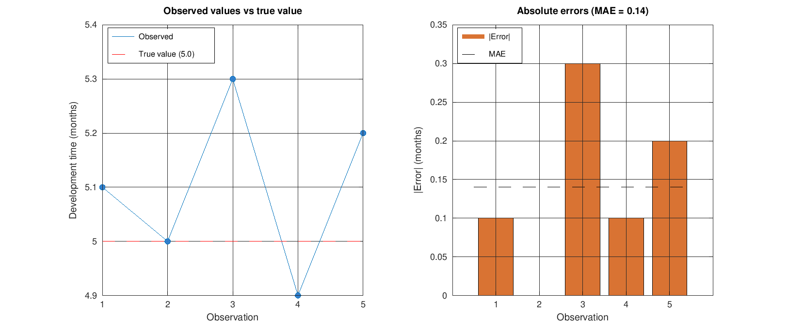
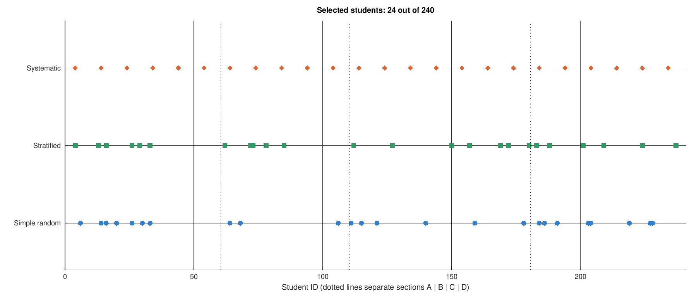
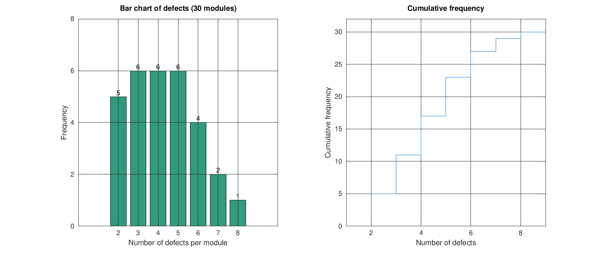
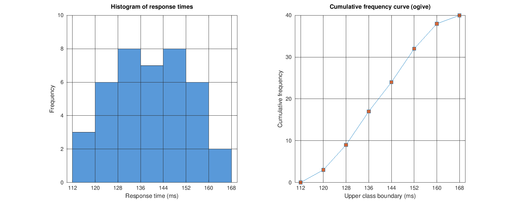
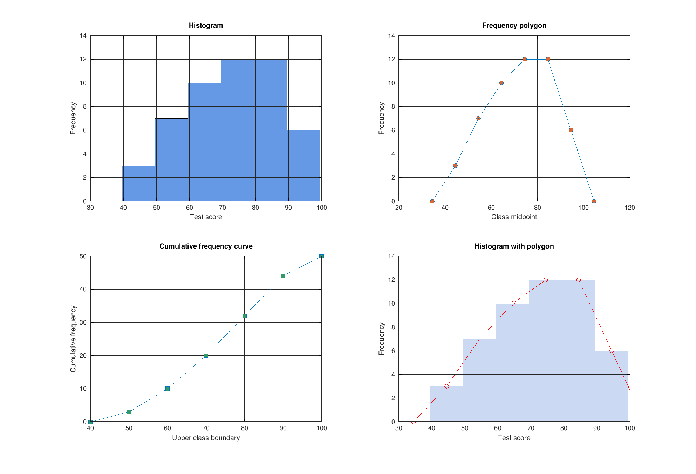
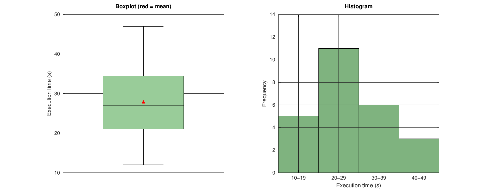
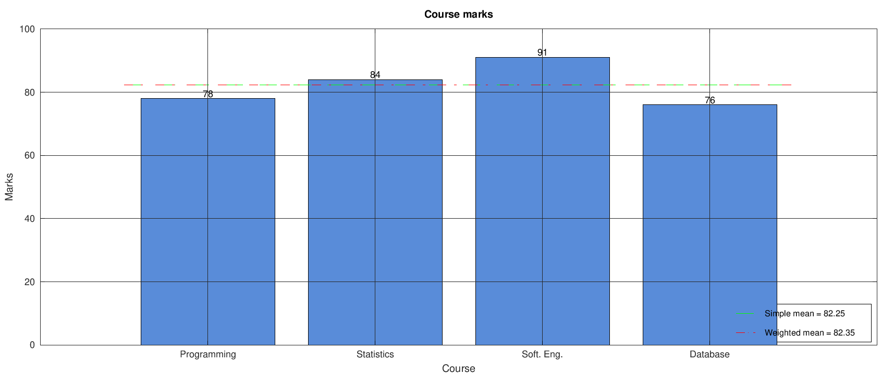

# Statistics and Probability - MATLAB Assignment 1

**Name:** M. Abdullah  **Reg. No:** FA23-BSE-129  
**Submitted to:** Sir Haider Ali  **Subject:** Statistics and Probability

MATLAB scripts that reproduce the manual (handwritten) solution of Assignment 1.
Every script prints the same values as the manual work and saves its graph in `Assignment1/images/`.
The scripts run in MATLAB and in GNU Octave. To run everything: open `Assignment1/` and run `run_all`.

| Question | Topic | Script | Graph |
|---|---|---|---|
| Q1 | Variables, measurement scales, measurement error (MAE = 0.14 months) | `Question1.m` | `images/Q1_measurement_error.png` |
| Q2 | Sampling: simple random, stratified (6, 5, 7, 6), systematic (k = 10, start 4) | `Question2.m` | `images/Q2_sampling.png` |
| Q3 | Discrete frequency distribution of defects, mode = 3, 4, 5 | `Question3.m` | `images/Q3_discrete_frequency.png` |
| Q4 | Continuous data: Sturges (K = 7), width 8 ms, median class 136-143 | `Question4.m` | `images/Q4_continuous_frequency.png` |
| Q5 | Histogram, frequency polygon, cumulative frequency curve | `Question5.m` | `images/Q5_frequency_curves.png` |
| Q6 | Stem-and-leaf, mean 27.76, median 27, mode 21/24/28 | `Question6.m` | `images/Q6_stem_leaf_central_tendency.png` |
| Q7 | Mean 82.25, weighted mean 82.35, median 80, mode 74 | `Question7.m` | `images/Q7_course_marks.png` |

## Output graphs

### Q1

### Q2

### Q3

### Q4

### Q5

### Q6

### Q7

