# Statistics and Probability - MATLAB Assignment 2 (STA301, Lectures 1-15)

**Name:** M. Abdullah  **Reg. No:** FA23-BSE-129  
**Submitted to:** Sir Haider Ali  **Subject:** Statistics and Probability

MATLAB scripts for the 15 practice questions (one per lecture, Lectures 1 to 15).
Every script prints the same values as the step-by-step solution and saves its graph in `Assignment2/images/`.
The scripts run in MATLAB and in GNU Octave. Helper functions `qpos.m` ((n+1)p quartile rule) and `grpq.m` (quantiles of grouped data) are in the same folder.
To run everything: open `Assignment2/` and run `run_all`.

| Question | Topic | Script | Graph |
|---|---|---|---|
| Q1 | Variables, measurement scales, error of measurement (MAE = 0.4875 kg, mean % error = 1.2292) | `Question1.m` | `images/Q1_measurement_error.png` |
| Q2 | Sampling: simple random (N = 60, n = 6) and systematic (k = 10, start 4) | `Question2.m` | `images/Q2_sampling.png` |
| Q3 | Discrete frequency distribution of defects, mode = 1 | `Question3.m` | `images/Q3_discrete_frequency.png` |
| Q4 | Continuous data: Sturges (k = 6), width 5, modal class 60-65 | `Question4.m` | `images/Q4_continuous_frequency.png` |
| Q5 | Frequency polygon, less-than ogive, median = 52.5 | `Question5.m` | `images/Q5_frequency_curves.png` |
| Q6 | Stem-and-leaf display, mode = 38 | `Question6.m` | `images/Q6_stem_leaf_mode.png` |
| Q7 | Weighted mean 80.2, simple mean 76.75, mean 15.11, median 15 | `Question7.m` | `images/Q7_weighted_mean.png` |
| Q8 | Grouped data: mean 42.40, median 42.67, Q1 33.20, Q3 51.67, D9 60, mode 42.94 | `Question8.m` | `images/Q8_quantiles_ogive.png` |
| Q9 | AM 12.4, GM 8, HM 5.1613, average speed 64 km/h | `Question9.m` | `images/Q9_AM_GM_HM.png` |
| Q10 | Range 33, QD 10, coefficients 0.5789 and 0.3571 | `Question10.m` | `images/Q10_range_quartile_deviation.png` |
| Q11 | Mean deviation, SD, variance, CV (A = 14.02 %, B = 64.42 %) | `Question11.m` | `images/Q11_consistency_comparison.png` |
| Q12 | Chebyshev vs Empirical rule, five-number summary 35, 51, 62, 75, 95 | `Question12.m` | `images/Q12_chebyshev_empirical.png` |
| Q13 | Pearson skewness (0.424, 0.719), box plot, outlier 60 | `Question13.m` | `images/Q13_boxplot_skewness.png` |
| Q14 | Moments, Sheppard's corrections, b1 = 0.3459, b2 = 2.9577, Bowley 0.0670 | `Question14.m` | `images/Q14_moments_skewness_kurtosis.png` |
| Q15 | Regression Y = 30.20 + 5.7455X, r = 0.9970, Se = 1.4254, prediction 73.29 | `Question15.m` | `images/Q15_regression.png` |

## Output graphs

### Q1
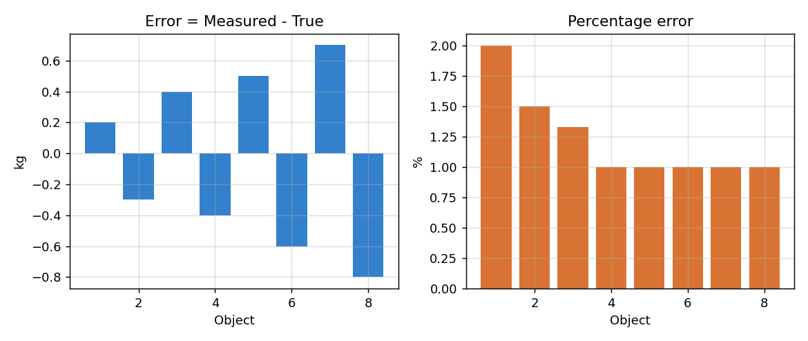
### Q2
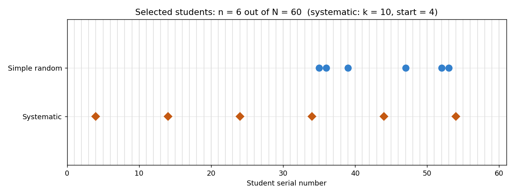
### Q3
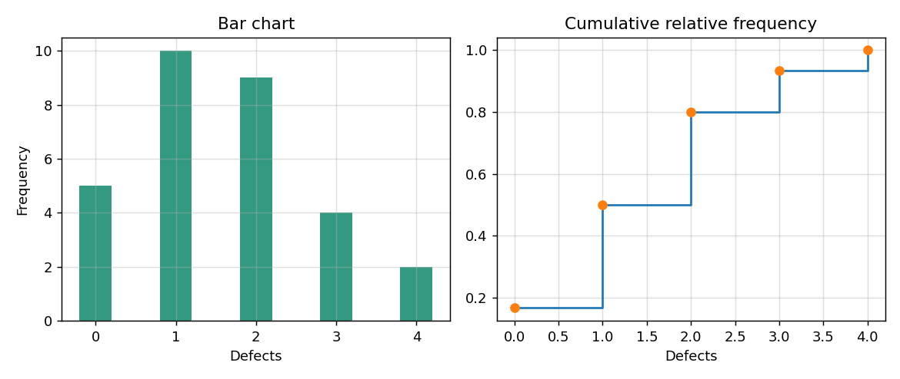
### Q4
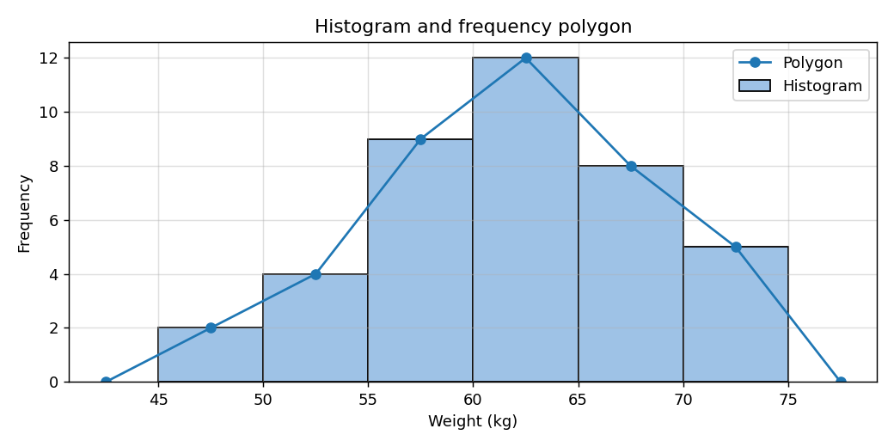
### Q5
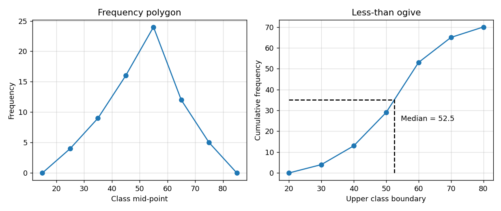
### Q6
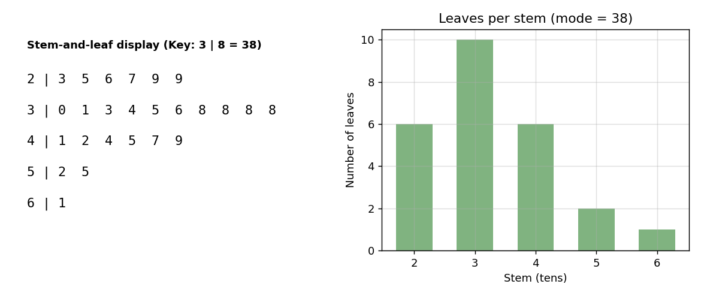
### Q7
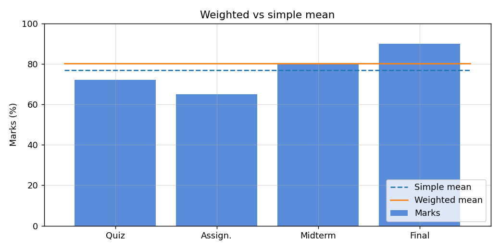
### Q8
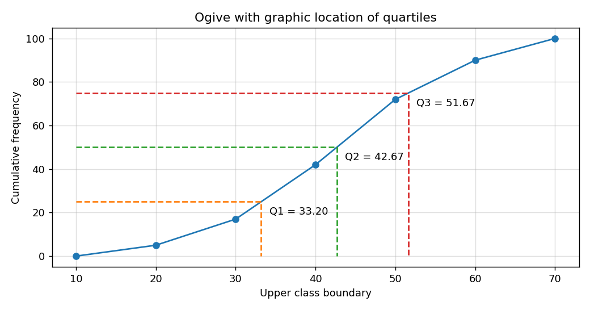
### Q9
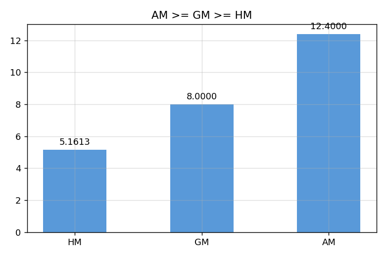
### Q10
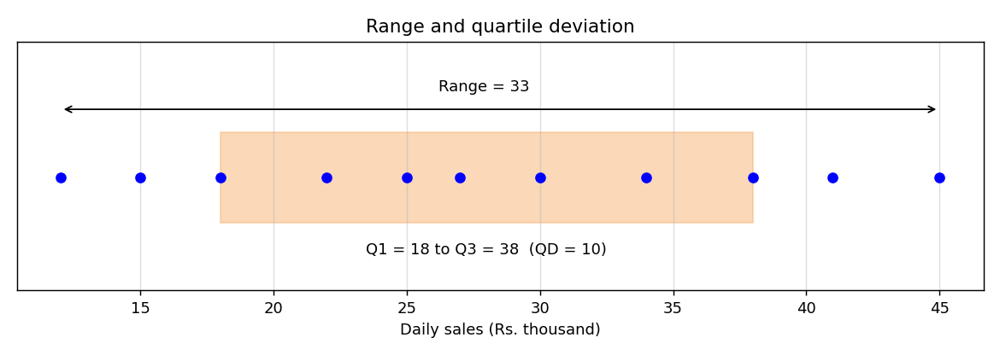
### Q11
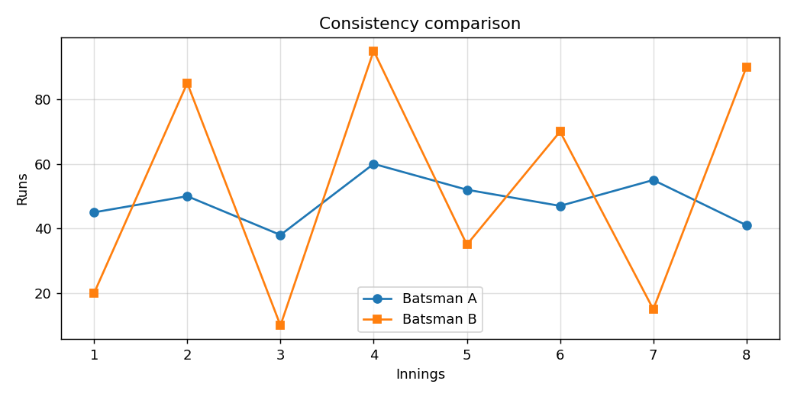
### Q12
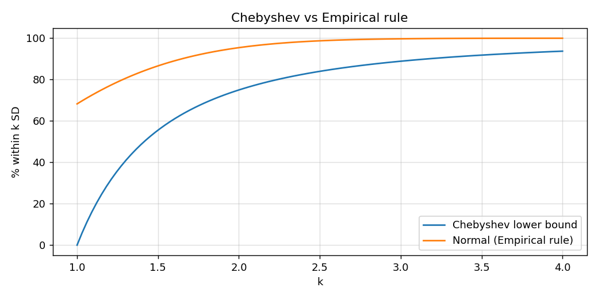
### Q13
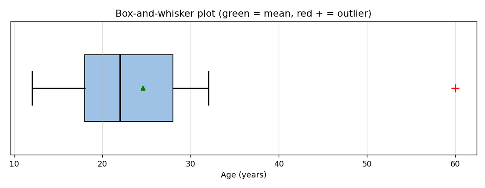
### Q14
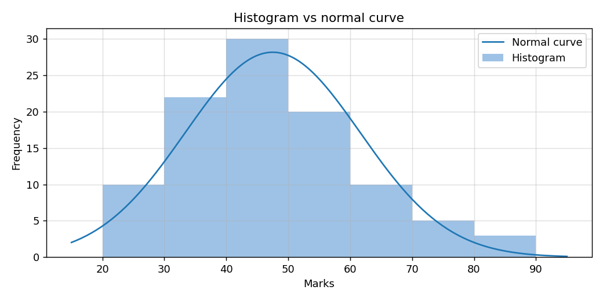
### Q15
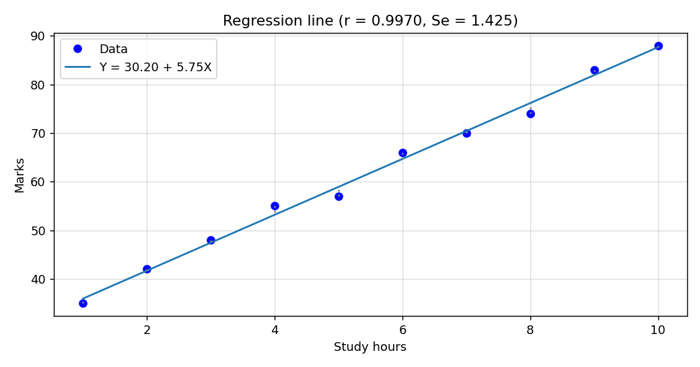
